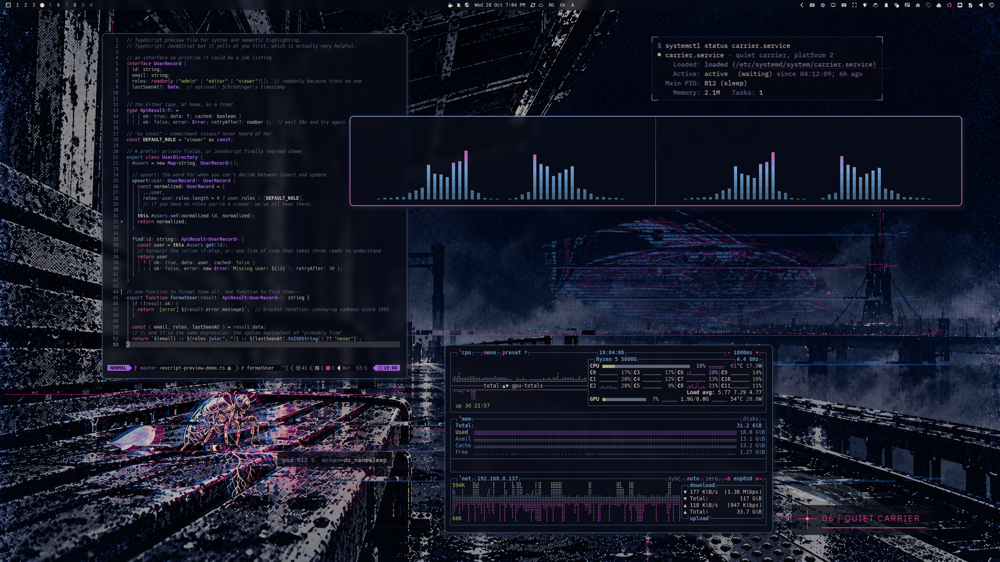
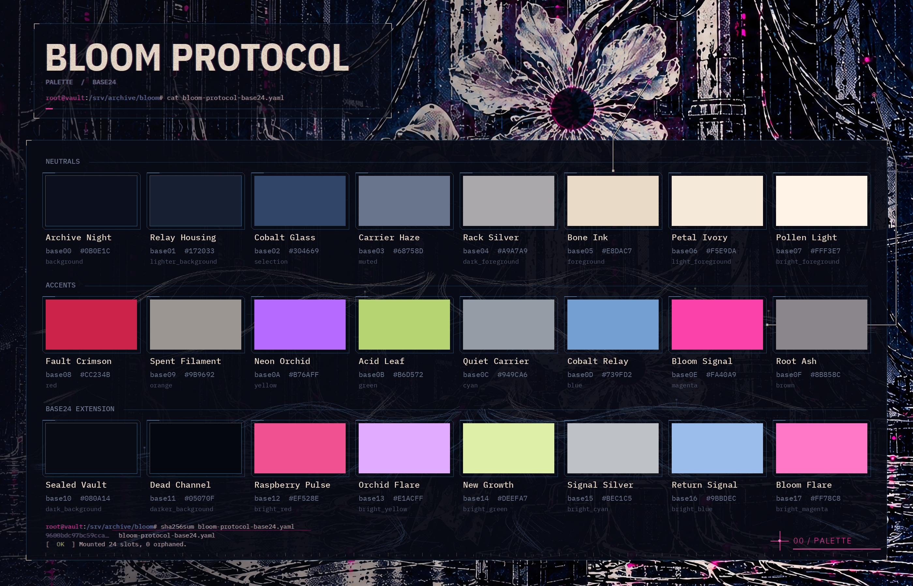
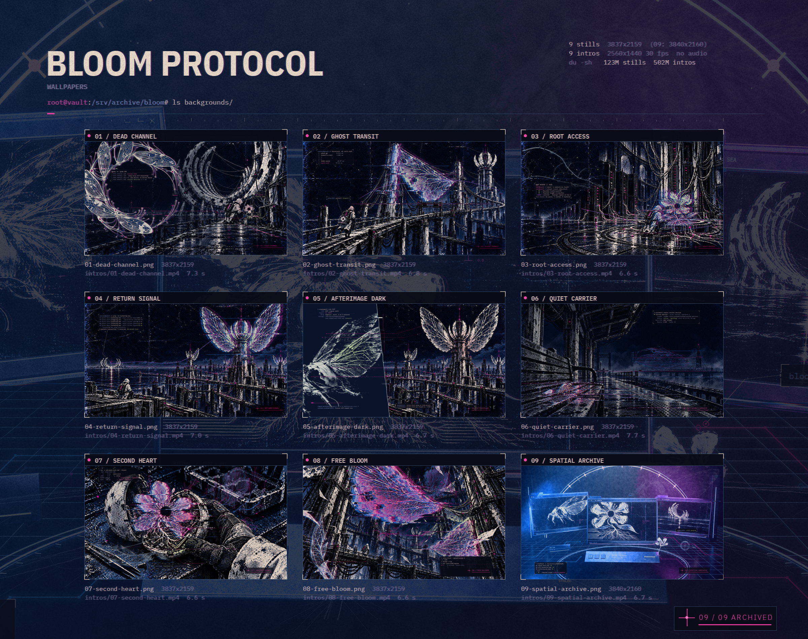

# Omarchy Bloom Protocol Theme

Cobalt focus, neon-pink signal, bone text. A near-black Omarchy theme paired with nine wallpapers of overgrown machinery, fractured archives, and flowers finding their way through.

## Preview



A real Omarchy desktop using **Quiet Carrier**. The screenshot shows a personal window arrangement and application setup, not a layout installed by the theme. See the compatibility notes below for differences between Git installs and local working copies.

## Palette



The full Base24 scheme, named and mapped to its `colors.toml` keys. Neutrals run from Archive Night to Pollen Light; the accents are limited inks around Cobalt Relay (focus) and Bloom Signal (signal pink), with Neon Orchid standing in for yellow as the caution color. The scheme file is `bloom-protocol-base24.yaml`; `colors.toml` is the operative palette and the card is rendered from both.

## Install

Copy this repository's clone URL from the **Code** menu, then run:

```bash
omarchy theme install
```

Paste the URL when prompted. Omarchy downloads and activates the theme.

To select it again later:

```bash
omarchy theme set bloom-protocol
```

**Size:** allow roughly 650 MiB for the theme assets, including all nine wallpaper intros.

## Wallpapers



Nine near-4K stills, each with a matching animated intro. Eight are 3837×2159; **Spatial Archive** is 3840×2160. Full-resolution files are in `backgrounds/`.

### Wallpaper intros

Every still has a short, silent intro in `backgrounds/intros/`. The clips run for roughly **6.6–7.7 seconds**, at **2560×1440 / 30 fps**, and lead into the matching wallpaper.

Playback requires an Omarchy build with wallpaper-intro support enabled. On versions without that feature, the still wallpapers remain available. The intros account for approximately **502 MiB** of the theme assets.

## Optional Cava theme

The included `cava_theme` moves from blue-steel through cobalt into neon-pink peaks. It preserves your terminal background and transparency, and does not change your audio input or bar settings.

If you already use **THPM**, its Cava integration selects this authored gradient instead of the generated fallback. Enable it with:

```bash
thpm enable cava
```

Read and confirm the setup prompt. This integration requires **Cava 0.10.6 or newer**; installing Bloom Protocol alone does not enable it. Cava and the other applications in the screenshot are not installed by the theme.

## Compatibility and notes

- **Omarchy 4 / Quattro** is the primary target. Native shell surfaces are styled through `shell.toml`, with colors sourced from `colors.toml`.
- **Git installs:** current Omarchy ignores theme-supplied Lua and terminal configs, generating replacements from the palette. Bloom Protocol's shell styling and btop theme are retained, but its authored `hyprland.lua` and `foot.ini` are not loaded. Window geometry, blur, shadows, and terminal presentation can therefore differ from a local working copy and from the screenshot.
- **Omarchy 3.8:** legacy surface files are included, but that runtime has not been verified for this release.
- **GTK:** `gtk.css` only applies if your setup loads it; file presence alone does not enable GTK theming.
- The ANSI slot named `yellow` intentionally contains orchid rather than literal yellow. Applications decide how those color slots map to their own states.
- Wallpaper and intro provenance, dimensions, and SHA-256 hashes are recorded in `backgrounds/SOURCES.json`.

### Unauthorized access :)

For an optional, unsupported local-working-copy route, see Ministry of Taste's **theme-link**:

https://github.com/ministry-of-taste/theme-link

It clones a trusted theme into a user-owned store and symlinks it into Omarchy, without activating it. Some Omarchy versions treat that symlink as a local working copy and retain the authored overrides.

**Only use this route with sources you trust.** It bypasses Git-theme restrictions; it is not a sandbox. Theme code can run with your user permissions. Read theme-link's warnings before opting in. Compatibility with future Omarchy versions is not guaranteed.
